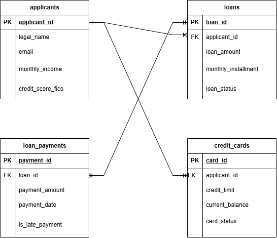

\# Real-Time Credit Risk \& Lending Scoring Engine

\### 🏦 A High-Performance Fintech Analytics Pipeline Built with 3NF PostgreSQL, R, and Quarto


\[!\[Quarto](https://shields.io)](https://quarto.org)

\[!\[PostgreSQL](https://shields.io)](https://postgresql.org)

\[!\[R](https://shields.io)](https://r-project.org)


This repository contains an end-to-end, production-ready credit risk scoring system built completely inside a reproducible Quarto (.qmd) infrastructure. The engine addresses a common structural problem in financial tech architectures: converting flat-file data into clean, third-normal form (3NF) structures, and executing intensive analytical models directly inside the database kernel to eliminate server network bottlenecks.


\---


\## 🏛️ System Architecture \& Data Flow


Traditional financial pipelines fail because they extract multi-gigabyte flat tables from storage into application RAM to perform calculations. This engine utilizes \*\*In-Database Processing\*\* via `dbplyr`, keeping data securely locked in its relational environment and forcing the server to do the computational heavy lifting.


```text

&#x20;  ┌────────────────────────────────┐

&#x20;  │       1. Raw Data Input        │

&#x20;  │ (U.S. Formatted Lending Files) │

&#x20;  └───────────────┬────────────────┘

&#x20;                  │

&#x20;                  â–¼

&#x20;  ┌────────────────────────────────┐

&#x20;  │  2. Core Postgres DB (3NF)     │  ◄── Enforces ACID Integrity

&#x20;  │  (applicants, loans, payments) │      \& Strict Check Constraints

&#x20;  └───────────────┬────────────────┘

&#x20;                  │  dbplyr Virtual Link (No Local Memory Waste)

&#x20;                  â–¼

&#x20;  ┌────────────────────────────────┐

&#x20;  │       3. R Logic Engine        │  ◄── Translates R Into Local SQL;

&#x20;  │   (Quarto Rendered Report)     │      Computes DTI \& Risk Tiers

&#x20;  └────────────────────────────────┘

```


\---


\## 🛠️ The Database Design (3NF Normalization)


To eliminate data redundancy, prevent update/deletion anomalies, and resolve visualization container clipping, data is decoupled into three highly narrow, indexed tables:


1\. \*\*`applicants`\*\*: Single source of truth for verified client legal identities and baseline metrics.

2\. \*\*`loans`\*\*: Isolated operational ledger storing active loan contract parameters.

3\. \*\*`loan\_payments`\*\*: An append-only chronological transaction stream logging repayment behavior.


\### 🛡️ Enterprise Safeguards Applied

\* \*\*U.S. Date Conformity:\*\* Custom pipelines handle incoming `MM/DD/YYYY` text strings, parsing them directly into queryable PostgreSQL `DATE` types via `lubridate`.

\* \*\*Exact Floating Protection:\*\* Financial amounts are structurally bound to `NUMERIC(12,2)` parameters to completely block binary floating-point rounding errors.

\* \*\*Database-Level Firebreaks:\*\* Hard constraints (`CHECK (credit\_score\_fico BETWEEN 300 AND 850)`) instantly reject corrupted files before bad records hit the hard disk.


\---


\## 🚀 How to Run the Pipeline Locally


\### 1. Prerequisites

Ensure you have an active instance of \*\*PostgreSQL\*\* running locally and that \*\*R\*\* is installed on your computer.


\### 2. Clone the Repository

```bash

git clone https://github.com

cd credit\_risk\_engine

```


\### 3. Open and Render in Quarto

You can compile the entire interactive portfolio dashboard using your terminal or within RStudio.


\*\*Via Terminal:\*\*

```bash

quarto render credit\_risk\_pipeline.qmd --to html

```


This will automatically create a highly optimized, single-file interactive \*\*HTML data dashboard\*\* (`index.html`) featuring clickable code blocks, formatted metrics tables, and dynamic mathematical summaries.


\---


\## 📈 Portfolio Project Impact Metrics


When talking to remote technical interviewers, this setup demonstrates three key masteries:

\* \*\*Production-Grade Data Hygiene:\*\* Showcases the conversion of chaotic strings (such as packed strings under `Loan\_Details`) into clean relational variables via automated regular expressions (`str\_extract`).

\* \*\*Cost-Efficient Compute Optimization:\*\* Proves you can manage database connectivity asynchronously without flooding local machine memory with massive files.

\* \*\*Fully Automated Workflows:\*\* Demonstrates standard enterprise configuration patterns by embedding complete database migration commands directly into reproducible reporting documentation.


## 3NF Relational Database Architecture (ERD)


